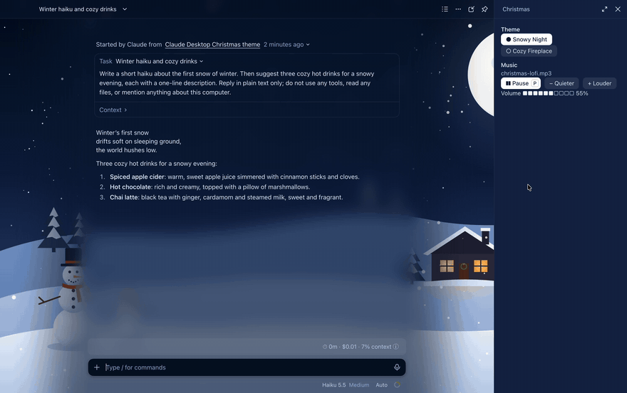

# Christmas Themes for Claude Desktop

A growing collection of animated Christmas looks for the Claude desktop app, with a
control pane for switching themes and playing lofi Christmas music on loop.



*Snowy Night, then Cozy Fireplace, switched from the Christmas pane. [MP4 version](docs/demo.mp4).*

## Install

At the prompt of a Claude Code terminal session:

```
/plugin install christmas-themes --marketplace swperb/claude-desktop-christmas-themes
```

Answer `y` to add the marketplace, then pick a scope (Enter for your user scope).

From a shell:

```bash
claude plugin install christmas-themes --marketplace swperb/claude-desktop-christmas-themes
```

In the desktop app, where `/plugin` does not run: click **+** next to the prompt box, then
**Plugins**, **Add marketplace** with `swperb/claude-desktop-christmas-themes`, then **Add plugin**.

Update later with `claude plugin update christmas-themes`.

## Snowy Night
A moonlit winter scene in deep blues: snow drifting down in three layers, two snowmen
(one waving) on the left, another on the right, a cabin with warm windows and a wisp of
chimney smoke, and every 75 seconds or so Santa's sleigh and reindeer cross the moon.
The app's panels are tinted to match, with frosted glass over the scene.

## Cozy Fireplace
A warm living room by firelight: a crackling fire with rising sparks, three stockings
swaying on the mantel under a twinkling garland, two flickering candles, a cat asleep on
the rug, a Christmas tree with blinking lights and presents, and snow falling past the
window.

## Music
The plugin comes with **Christmas Lofi**, a ~36-minute mix of openly licensed tracks that
plays on loop behind the themes:

- **HoliznaCC0**: nine tracks from *A Lo-Fi Christmas Special* and *Winter Lofi*, public
  domain ([CC0 1.0](https://creativecommons.org/publicdomain/zero/1.0/)).
- **Lobo Loco**: "Christmas Market (ID 2402)" and "Sheperd Angels (ID 2405)" from
  *Christmas Market (CC BY)*, licensed under
  [CC BY 4.0](https://creativecommons.org/licenses/by/4.0/).

Tracks were loudness-normalized and joined with crossfades. Full per-track credits and
links: [music/CREDITS.md](music/CREDITS.md).

To play your own music instead, drop one audio file (.mp3, .m4a, .aac, .wav, .aiff or
.flac) into `~/Music/Claude Christmas`; that folder is checked first and survives plugin
updates.

With [ffmpeg](https://ffmpeg.org) installed (`brew install ffmpeg`), pause and volume
changes resume exactly where the music was. Without it, macOS's `afplay` plays the track
from the top each time.

## Control pane
A "Christmas" pane opens beside the chat: one button per theme, Play/Pause (hotkey `p`
while the pane has focus), Quieter/Louder in 10% steps, and a volume meter. With ffmpeg
installed, pause and volume changes resume exactly where the music was, and the spot is
remembered between sessions.

## Commands
- `/christmas`: open the control pane
- `/christmas list`: the themes and whether music is playing
- `/christmas <theme>`: switch theme (remembered across sessions)
- `/christmas music on|pause|off`: play or pause the music (remembered)
- `/christmas volume 0-100`: set the volume

## Development
The scenes are hand-drawn SVG generated by the scripts in `tools/`
(`node tools/gen-cozy-fireplace.mjs hooks/scenes/cozy-fireplace.ts`). Run `scripts/check.sh`
to validate and test, and see [RELEASING.md](RELEASING.md) for releases and hotfixes.

## License
Code: MIT. Music: CC0 1.0 and CC BY 4.0 per track, see [music/CREDITS.md](music/CREDITS.md).
